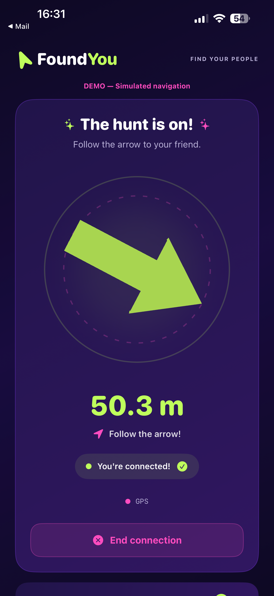

# FoundYou

**Real-Time Person Finding with GPS, Ultra-Wideband and 3D Navigation**

FoundYou is a native iOS application designed to help people locate each other in crowded environments using a simple, direction-based interface.

Instead of navigating through a traditional map, users follow a 3D directional arrow that responds to device orientation and available positioning data.

The project explores the integration of location services, device sensors, proximity technologies, and real-time communication into a unified navigation experience.
## Screenshots

  
  
  

*Pairing, connection, and 3D navigation. Navigation screenshot uses simulated location data for demonstration.*

## Tech Stack

- **Language:** Swift
- **UI:** SwiftUI
- **3D Rendering:** RealityKit
- **Location:** CoreLocation
- **Motion & Orientation:** CoreMotion
- **Proximity:** Nearby Interaction / Ultra-Wideband (UWB)
- **Backend:** Firebase Authentication and Realtime Database
- **Development:** Xcode

## Core Features

### GPS-Based Directional Navigation

Calculates geographical bearing and distance between two coordinates to guide the user toward another person.

### Ultra-Wideband Integration

Integrates Apple's Nearby Interaction framework to support proximity-based positioning on compatible devices.

### Interactive 3D Arrow

Uses RealityKit and device orientation data to present navigation through a single three-dimensional directional indicator.

### Session-Based Pairing

Implements a pairing workflow for connecting two users through a temporary code and managing the connection lifecycle.

### Accuracy-Aware GPS Filtering

Implements an on-device GPS filtering component designed to:

- Reject inaccurate or outdated location measurements.
- Detect suspicious GPS jumps.
- Apply movement thresholds.
- Reduce unnecessary cloud location updates.
- Reset location tracking state between sessions.

### Location Sharing Lifecycle

Coordinates location publishing with active finding sessions and separates local navigation calculations from remote location updates.

## Architecture

The application separates responsibilities across several components:

| Component | Responsibility |
|---|---|
| TrackingCoordinator | Coordinates tracking and session lifecycle |
| NavigationManager | Manages navigation data and positioning sources |
| GPSFilter | Validates location readings and determines upload eligibility |
| PairingManager | Manages user pairing and connection states |
| NearbyInteractionManager | Handles UWB proximity interactions |
| MotionManager | Processes device orientation |
| LiveLocationManager | Coordinates remote location publishing |
| Arrow3DView | Renders the navigation arrow |

## Engineering Focus

**Sensor Integration:** Combining geographical positioning, device orientation, and proximity information.

**Data Efficiency:** Avoiding unnecessary remote location updates when movement is insufficient or measurements are unreliable.

**State Management:** Coordinating pairing, active navigation, connection termination, and tracking cleanup.

**Privacy-Aware Design:** Using session-based location sharing and minimizing unnecessary location transmission.

**Modular Architecture:** Separating navigation logic, sensor management, session coordination, and presentation components.

## Development Status

FoundYou is an actively developed prototype.

The application architecture and core components have been implemented. End-to-end behavior, GPS/UWB transitions, and reliability across two physical iPhones require further validation.

This repository is shared as a software engineering portfolio project and should not be interpreted as a production-ready navigation or safety system.

## Author

**Burak Giritlioglu**

Software Engineer | iOS Development | Automation | Infrastructure Engineering
